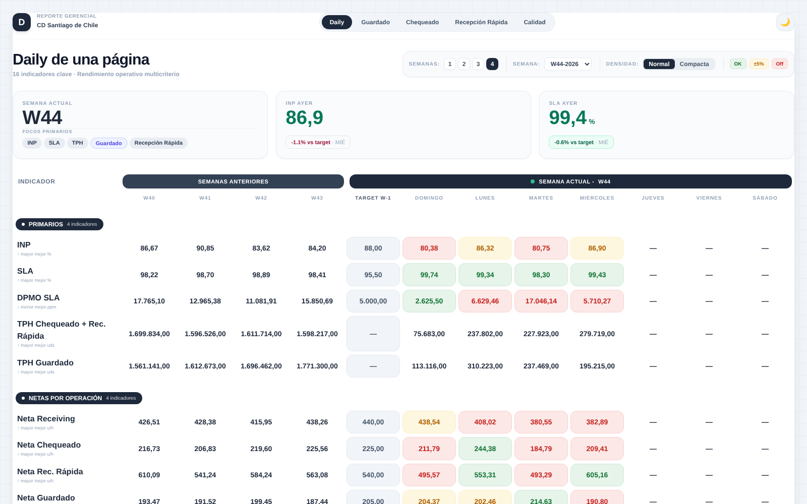

# Daily de una página — Reporte gerencial de Operaciones Inbound

Reporte ejecutivo que reúne **todos los KPIs de la operación en un solo lugar**: productividad, calidad, servicio y asistencia, día a día de la semana actual contra las 4 semanas anteriores y el target. Lo alimenta un workflow **n8n** que corre cada mañana con **un solo disparo** y calcula todo en **BigQuery**.

> Versión **anonimizada**: tablas, proyectos, hosts y centro de distribución reemplazados, y el demo usa **datos sintéticos**.



## Qué muestra

**Pestaña Daily**
- Tarjetas con la semana actual, el INP de ayer y el SLA de ayer, cada una contra su target.
- Tabla con 16 indicadores en 4 grupos:

| Grupo | Indicadores |
|---|---|
| **Primarios** | INP, SLA, DPMO SLA, TPH Chequeado + Recepción Rápida, TPH Guardado |
| **Netas por operación** | Productividad neta (u/h) de Receiving, Chequeado, Recepción Rápida y Guardado |
| **Operativos complementarios** | Share Recepción Rápida, Attendance (AT), TEO Inbound Audit |
| **Calidad** | Contact Rate, % Reaperturas, Inbound Audit, DPMO Cruce, DPMO Faltante |

- Semáforo automático por celda: **OK**, **±5%** u **Off**. Considera si el indicador mejora al subir o al bajar.
- Controles para elegir semana, cuántas semanas anteriores mostrar (1 a 4), densidad y modo oscuro.

**Pestañas Guardado, Chequeado y Recepción Rápida**
Cascada de palancas de productividad: cuánto suma o resta cada factor (NH1–NH4, nativos, binfullness, volumetría, tamaño de tote…). También muestran métricas por turno.

**Pestaña Calidad**
Precisión de auditoría, DPMO e incidencias.

## Arquitectura

```
 n8n: Trigger diario 06:00 (1 botón / 1 disparo)
   ├─ Productividad  (semanal + diaria) ─┐
   ├─ Calidad        (semanal + diaria) ─┤  BigQuery → Aggregate →
   ├─ Volumetría     (semanal + diaria) ─┤  API upload-url → PUT → publish
   └─ Asistencia AT  (semanal + diaria) ─┘
                                           ↓
                               dashboard/index.html
```

Son 8 consultas que se publican como datasets independientes, con esperas escalonadas para no saturar la API.

## Estructura

```
dashboard/
  index.html          Reporte (HTML + JS) con generador de datos de ejemplo
  assets/tailwind.css Estilos compilados (Tailwind CSS)
n8n/workflow.json     Workflow para importar
sql/                  Las 8 consultas (productividad, calidad, volumetría, asistencia)
docs/img/             Capturas
```

## Cómo verlo

Abre `dashboard/index.html` en el navegador. Para usar datos reales, deja `dashboard/data/daily.json` con la forma `{ "prod": [...], "cal": [...], "at": [...] }` y sirve la carpeta por HTTP.

## Tecnologías

HTML · JavaScript · Tailwind CSS · n8n · Google BigQuery (SQL)

## Autor

Julio Novoa
